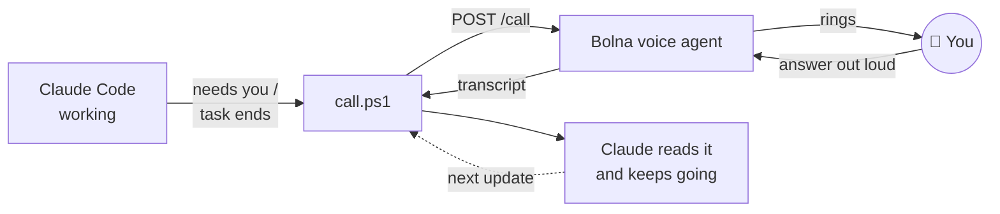

<div align="center">

# 📞 claude-call-me

### Walk away. Claude calls you.

A Claude Code skill that **phones you** when it needs a decision, **calls with an update** every time a task ends, and runs a **daily standup call** about yesterday's work. You answer out loud; Claude gets back to work.

[](LICENSE)
[](https://docs.claude.com/en/docs/claude-code/skills)
[](https://www.bolna.ai)
[](#install)

<a href="assets/promo.mp4"></a>

<sub>▶ Click for the full video with sound · made with <a href="https://github.com/MithunSidhaarth/motionspec">motionspec</a>, from <a href="video/spec.json">one JSON file</a></sub>

</div>

---

## Why

Long Claude Code tasks have a failure mode: you walk away, Claude hits a question only you can answer, and it sits there waiting for an hour. **claude-call-me** turns that wait into a 60-second phone call.

```
agent:  Postgres or SQLite for the cache?
you:    SQLite. Keep it simple.
agent:  SQLite, confirmed. Anything else before I let you go?
you:    That's all.
```

## Three ways it calls

| | When | What happens on the call |
|---|---|---|
| 🛑 **Blocked** | Claude hits a decision only you can make | It asks the question, gives options, confirms your answer, and Claude continues with it. |
| ✅ **Task done** | A session where you said *"call me when done"* finishes | A spoken update, 2–4 next steps to pick from, plus any extra instructions. Claude does it **live**, then calls again until you say "that's all". |
| ☀️ **Daily standup** | Every morning (you pick the time) | A recap of yesterday's Claude Code sessions by project, then *"What should your agent focus on today?"* Saved for Claude to read later. |

## How it works



- **`call.ps1`** creates one reusable Bolna voice agent on first run, places the call with the question as the agent's prompt, polls until the call ends, and returns the transcript.
- **`stop-hook.ps1`** is a Claude Code `Stop` hook. In sessions where the skill was used, it holds Claude's first stop and asks for the update call. It never loops: one hook-triggered call per stop, and Claude keeps calling only while you keep giving it work.
- **`standup.ps1`** reads yesterday's top-level transcripts in `~/.claude/projects`, sends a short digest to the voice agent, and saves the recap + call to `~/.claude/call-me/standups/<date>.md`. No sessions means no call.

## Install

**You need:** Windows with PowerShell 5.1+, Claude Code, and a [Bolna.ai](https://www.bolna.ai) account (signup credit covers testing; trial accounts can only call numbers you verify in the Bolna dashboard).

```powershell
git clone https://github.com/MithunSidhaarth/claude-call-me
cd claude-call-me
.\install.ps1 -Standup 09:00
```

The installer:
1. copies the skill to `~/.claude/skills/call-me/`,
2. asks for your Bolna API key at a **hidden prompt** and your phone number, storing both as user environment variables,
3. registers the session-end `Stop` hook in `~/.claude/settings.json` (backup kept as `settings.json.bak`; skip with `-NoHook`),
4. schedules the daily standup with Task Scheduler (drop `-Standup` to skip).

Then in Claude Code:

```
call me when you're done
```

## Use

| Say to Claude | Effect |
|---|---|
| `call me if you get stuck` | Calls only for blocking decisions. |
| `call me when you're done` | Turns on session-end calls for this session. |
| `stop calling me` | Turns them off for this session. |
| `what's my focus today?` | Claude reads this morning's standup answer. |

## Privacy and cost

- 🔑 **Keys never touch the chat or a file.** They live in user environment variables; the skill tells Claude never to ask for, print or pass them.
- 📤 **What leaves your machine:** the question or update text (and, for standups, a short digest of yesterday's prompts and Claude's last replies) goes to Bolna and its speech/LLM providers to run the call.
- 💸 **Calls use your Bolna credit,** about 6¢ a minute on standard pricing at the time of writing. A typical call is about a minute.

## Layout

```
skill/SKILL.md        when and how Claude calls, session-end loop, standup
skill/call.ps1        place a call, wait, return the transcript
skill/stop-hook.ps1   Claude Code Stop hook for session-end calls
skill/standup.ps1     daily standup call
install.ps1           installer (skill, keys, hook, schedule)
video/                the promo: script, motionspec spec and theme
```

## License

The code is **MIT** ([LICENSE](LICENSE)): use it, fork it, ship it. The name, branding and promo video are the author's own ([NOTICE](NOTICE)): link back with them freely, but don't ship a fork under the same name.

Not affiliated with or endorsed by Anthropic or Bolna.

<div align="center"><sub>Built by <a href="https://mithunsidhaarth.in">Mithun Sidhaarth</a>, with Claude.</sub></div>
